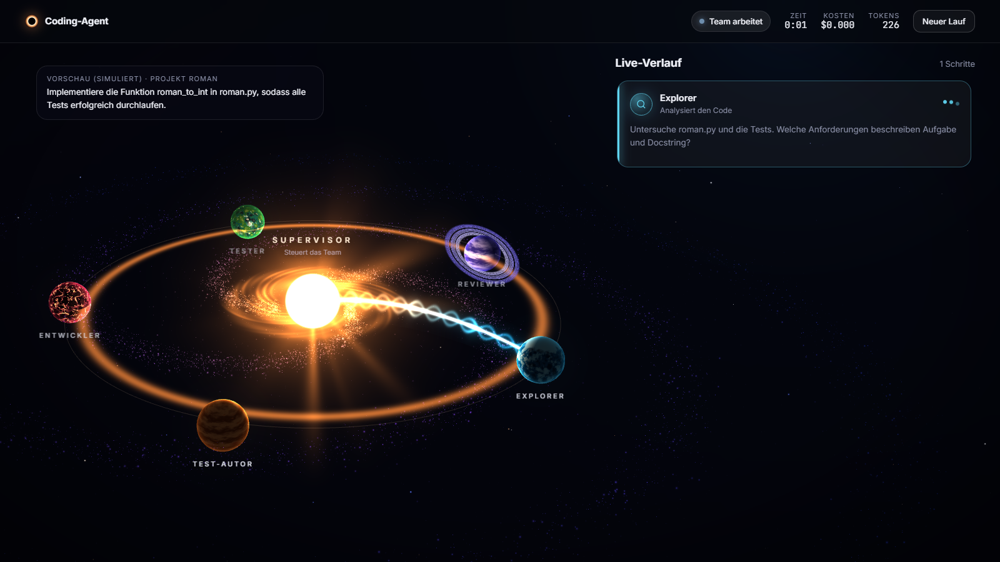

# Multi-Agent Coding Agent

[](https://github.com/LawandAbdullaAmin/multi-agent-coding-agent/actions/workflows/ci.yml)
[](https://LawandAbdullaAmin.github.io/multi-agent-coding-agent/)

An autonomous AI team built with LangGraph that fixes bugs in Python projects and implements features.
A supervisor hands out the work to five specialized agents. They analyze the code, write tests from the
requirements, write the code, run the tests in a Docker sandbox and check each other's work. At the end,
a human approves the result.

**Live demo:** [LawandAbdullaAmin.github.io/multi-agent-coding-agent](https://LawandAbdullaAmin.github.io/multi-agent-coding-agent/)
(static preview with a simulated run, no server and no cost)



## Highlights

- **Supervisor architecture in LangGraph:** one supervisor and five specialist agents with their own roles, tools and models
- **Guardrails in code instead of the prompt:** write permissions per role, finishing only with green tests and reviewer approval
- **Safe execution:** generated code runs in a Docker sandbox without network access and without write permissions
- **Human-in-the-loop:** review the diff, apply it, discard it or send feedback to the team
- **Persistence and tracing:** resume runs from SQLite checkpoints, every step traceable in LangSmith
- **Evaluation:** custom benchmark with hidden tests
- **Web interface:** FastAPI with live streaming and a 3D view of the team in Three.js

**Tech stack:** Python, LangGraph, LangChain (`create_agent`), OpenAI (`gpt-4.1`, `gpt-4.1-mini`), Docker,
SQLite, LangSmith, FastAPI, server-sent events, Three.js/WebGL, pytest, GitHub Actions

## Architecture

### Supervisor with specialist agents

```
                       +--> explorer     --+
                       +--> test_writer  --+
START -> supervisor ---+--> developer    --+--> supervisor --> ... --> review --> END
                       +--> tester       --+
                       +--> reviewer     --+
```

The **supervisor** is its own LangGraph node. It reads the specialists' reports and uses structured
output to decide who works next and with which instruction.
Typical flow: explorer → test_writer → developer → tester → reviewer.
The **specialists** are built with `create_agent` and only get the tools of their role:

| Agent | Model | Tools | May write | Role |
|---|---|---|---|---|
| explorer | cheap | `list_files`, `read_file`, `search_code` | nothing | find bug causes and unmet docstrings |
| test_writer | strong | read tools, `write_file`, `edit_file`, `run_tests` | only **new** test files | derive tests from the task and docstrings, each test backed by a quote |
| developer | cheap → strong | `read_file`, `search_code`, `edit_file`, `write_file` | only production code | change the code |
| tester | cheap | `run_tests`, `read_file` | nothing | run all tests |
| reviewer | strong | read tools, `show_changes`, `run_tests` | nothing | check the changes against the requirements, structured verdict (approved + gaps) |

**Enforced in code, not just in the prompt:**

- **Write permissions per role:** a forbidden write attempt is rejected by the tool. The agent gets an
  error message and can try a different approach. Nobody can change existing tests.
- **Finishing only after verification:** if the supervisor wants to finish although the last full test
  run is not green or the reviewer has not approved, the code automatically redirects to the tester
  or reviewer. Every code change invalidates an approval.
- **Test results from facts:** whether the tests pass is not decided by the model but by the actual
  exit code of the last run over *all* tests. Partial runs do not count as passed.
- **Model on demand:** judging roles use the strong model (`OPENAI_STRONG_MODEL`, default `gpt-4.1`),
  routine roles the cheap one (`OPENAI_MODEL`, default `gpt-4.1-mini`). The developer starts on the
  cheap model and automatically switches to the strong one as soon as it has to rework something.

**Human-in-the-loop:** when the supervisor is done, the graph pauses in the `review` node
(`interrupt`, state saved by a checkpointer). The human sees the diff and can

- **approve**: the changes are copied from the working copy into the repository,
- **discard**: the repository stays unchanged,
- **give feedback**: the graph continues with the feedback to the supervisor, the team reworks the
  result and presents it for approval again.

```
supervisor --(finish)--> review --(approve / discard)--> END
    ^                       |
    +------(feedback)-------+
```

**Persistent runs:** every run has a run ID. The graph's state is saved after every step in a
SQLite database (`.runs/checkpoints.sqlite`, `thread_id` = run ID). If a run is interrupted
(window closed, Ctrl+C, crash), `--resume` continues it from the last saved step. If it is
waiting for approval, it continues right there.

### Tools

| Tool | Purpose |
|---|---|
| `list_files` | list the files in the repository |
| `read_file` | read a file with line numbers |
| `search_code` | regex search in the code |
| `edit_file` | targeted, unique text replacement |
| `write_file` | create a new file |
| `run_tests` | run `pytest` in the Docker sandbox (with a time limit) |
| `show_changes` | all changes compared to the initial state as a diff |

## Security

- All tools are restricted to the repository folder.
- Parallel file edits are protected by a lock (no lost changes).
- Text containing control characters is not written. Small models occasionally mangle special
  characters such as `€` into `\x00`, which once destroyed a source file.
- The team works on a copy under `workspaces/`; the original only changes after approval.
- Code written by the agents only runs in a Docker container ([sandbox/Dockerfile](sandbox/Dockerfile)):
  no network, read-only file system, a dedicated user without root privileges,
  limits for RAM (512 MB), CPU and processes, and no API keys in the environment.

## Getting started

```
# once: copy .env.example to .env and add your OPENAI_API_KEY
pip install -r requirements.txt

python -m coding_agent --repo benchmark/tasks/calculator/repo
python -m coding_agent --repo <path> "Your own task"
python -m coding_agent --repo <path> --auto-approve   # without approval, e.g. for evaluations
python -m coding_agent --resume <run-id>              # continue an interrupted run
```

**Web interface:**

```
python -m coding_agent.web          # opens http://localhost:8000
```

A FastAPI server runs the graph in a background thread and streams every step to the browser via
server-sent events. The interface shows the team as a 3D galaxy (Three.js/WebGL): the supervisor is
the glowing core and the specialists orbit it as planets. Every instruction flies to the agent as an
energy beam, and every report flies back. Next to it, a live feed shows instructions, tool calls,
test results, reports and the running cost. At the end, the diff and test result are presented for
approval: apply, discard or send feedback to the team.

- **Budget mode:** all roles on the cheap model.
- **Preview:** a simulated run without model calls, also available as a static page on GitHub Pages.
- The server only listens on `127.0.0.1`. The benchmark tasks are copied before every run.

**Tracing (optional):** with `LANGSMITH_TRACING=true` and `LANGSMITH_API_KEY` in `.env`, every run is
recorded in LangSmith: every supervisor decision and every model and tool call of the specialists,
with tokens, cost and duration. Traces can be filtered by run ID, project and origin (CLI or evaluation).

Docker Desktop must be running. The sandbox image is built automatically on the first start.
Without Docker: `--no-sandbox` (tests then run locally; only use this for trusted code).

## Evaluation

A custom benchmark with 10 tasks in [benchmark/tasks/](benchmark/tasks/), ranging from off-by-one
errors and bugs in a different file than the tested one to a feature request in the style of an issue.

- **Hidden tests:** grading additionally uses tests from `hidden/` that the team never sees.
- **Protection against cheating:** grading always uses the original tests. If the team changes tests, this is flagged.
- **Verified benchmark:** a test makes sure that every task fails at first and passes with the
  reference solution from `solution/`.

```
python -m coding_agent.evaluate --repeats 3
```

**Results** (10 tasks × 3 repeats, reports in [benchmark/results/](benchmark/results/)):

| Version | Solved | Avg. duration | Avg. tokens | Avg. cost per task |
|---|---|---|---|---|
| Team v1: explorer, developer, tester (`gpt-4.1-mini`) | 25/30 (83 %) | 33 s | 22,293 | $0.013 |
| Team v2: + test_writer, reviewer, guardrails (`gpt-4.1-mini`) | 23/30 (77 %) | 67 s | 62,730 | $0.032 |
| Team v3: + quotes required for tests, control character protection (`gpt-4.1-mini`) | 25/30 (83 %) | 48 s | 39,549 | $0.020 |
| **Team v4: + model on demand (`gpt-4.1-mini` / `gpt-4.1`)** | **30/30 (100 %)** | 42 s | 33,916 | $0.066 |

What the iterations showed:

- **v1:** the team stops as soon as the visible tests are green. On `leap_year` it misses a bug
  that is only described in the docstring (0/3).
- **v2:** the test writer and reviewer solve `leap_year` (3/3), but the small model **invents requirements**
  (e.g. "minutes must be below 60") and builds them into tests and code. Overall a step backwards.
  In addition, a mangled `€` destroyed a source file.
- **v3:** requiring a quote for every test (from the task or a docstring) and having the reviewer check
  for invented rules reduces this, but does not eliminate it with `gpt-4.1-mini` (`duration` 0/3).
- **v4:** with the strong model for the supervisor, test writer, reviewer and rework, the team solves
  all tasks in all runs, at about 5 times the cost of v1.

**Limits of this measurement:**

- The tasks are small (1–3 files) and rather easy for current models. At 100 %, the benchmark is maxed out.
- The jump from v3 to v4 comes from the stronger model. How much the architecture alone contributes was not
  measured separately (that would require a comparison with a simpler system on the same model).
- The costs are estimated from token counts and list prices, without discounts for cached input.
- These results were measured with the original German prompts and task texts. The project has since been
  translated to English and has not been re-evaluated yet.

## Tests

```
python -m pytest
```

Runs automatically on every push in GitHub Actions.

## Project structure

```
coding_agent/
  team.py        graph: supervisor, specialists, guardrails, approval node
  tools.py       tools with role permissions and the Docker sandbox
  runs.py        runs, working copies, checkpointing
  evaluate.py    benchmark evaluation
  __main__.py    command line
  web/           FastAPI server, event translation, interface (static/)
benchmark/tasks/ 10 tasks with repository, hidden tests and reference solution
benchmark/results/ measurements of the iterations
sandbox/         Docker image for running the tests
tests/           tests for tools, graph, runs, benchmark and web interface
```

## Roadmap

- Larger projects: a repo map for codebases with many files
- Evaluation on real open-source bugs (SWE-bench Lite)
- Control measurement: the architecture's contribution separated from the model

## License

MIT, see [LICENSE](LICENSE). Three.js (MIT) is included unchanged under `coding_agent/web/static/vendor/`.
