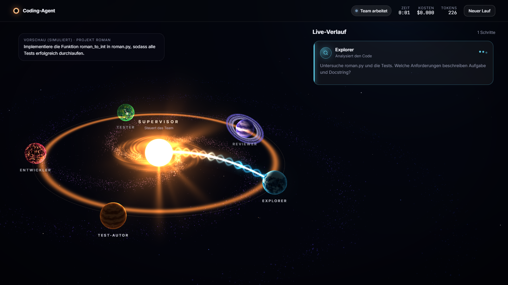

# Multi-Agent Coding-Agent

[](https://github.com/LawandAbdullaAmin/multi-agent-coding-agent/actions/workflows/ci.yml)
[](https://LawandAbdullaAmin.github.io/multi-agent-coding-agent/)

Ein autonomes KI-Team mit LangGraph, das Fehler in Python-Projekten behebt und Features umsetzt.
Ein Supervisor verteilt die Arbeit an fünf spezialisierte Agenten: Sie analysieren den Code, schreiben
Tests aus der Anforderung, programmieren, führen die Tests in einer Docker-Sandbox aus und prüfen sich
gegenseitig. Der Mensch gibt das Ergebnis am Ende frei.

**Live-Demo:** [LawandAbdullaAmin.github.io/multi-agent-coding-agent](https://LawandAbdullaAmin.github.io/multi-agent-coding-agent/)
(statische Vorschau mit simuliertem Lauf, ohne Server und ohne Kosten)



## Highlights

- **Supervisor-Architektur in LangGraph:** ein Supervisor und fünf Fach-Agenten mit eigenen Rollen, Werkzeugen und Modellen
- **Guardrails im Code statt im Prompt:** Schreibrechte pro Rolle, Abschluss nur mit grünen Tests und Freigabe des Reviewers
- **Sichere Ausführung:** generierter Code läuft in einer Docker-Sandbox ohne Netzwerk und ohne Schreibrechte
- **Human-in-the-loop:** Diff prüfen, übernehmen, verwerfen oder Feedback an das Team geben
- **Persistenz und Tracing:** Läufe mit SQLite-Checkpoints fortsetzen, jeder Schritt in LangSmith nachvollziehbar
- **Evaluation:** eigener Benchmark mit versteckten Tests
- **Weboberfläche:** FastAPI mit Live-Streaming und einer 3D-Ansicht des Teams in Three.js

**Tech-Stack:** Python, LangGraph, LangChain (`create_agent`), OpenAI (`gpt-4.1`, `gpt-4.1-mini`), Docker,
SQLite, LangSmith, FastAPI, Server-Sent Events, Three.js/WebGL, pytest, GitHub Actions

## Architektur

### Supervisor mit Fach-Agenten

```
                       +--> explorer     --+
                       +--> test_writer  --+
START -> supervisor ---+--> developer    --+--> supervisor --> ... --> review --> END
                       +--> tester       --+
                       +--> reviewer     --+
```

Der **Supervisor** ist ein eigener LangGraph-Knoten. Er liest die Berichte der Fach-Agenten und
entscheidet per strukturierter Ausgabe, wer als Nächstes arbeitet und mit welchem Auftrag.
Typischer Ablauf: explorer → test_writer → developer → tester → reviewer.
Die **Fach-Agenten** sind mit `create_agent` gebaut und bekommen nur die Werkzeuge ihrer Rolle:

| Agent | Modell | Werkzeuge | Darf schreiben | Rolle |
|---|---|---|---|---|
| explorer | günstig | `list_files`, `read_file`, `search_code` | nichts | Fehlerursachen und nicht erfüllte Docstrings finden |
| test_writer | stark | Lesen, `write_file`, `edit_file`, `run_tests` | nur **neue** Testdateien | Tests aus Aufgabe und Docstrings ableiten, jeder Test mit Zitat als Beleg |
| developer | günstig → stark | `read_file`, `search_code`, `edit_file`, `write_file` | nur Produktivcode | Code ändern |
| tester | günstig | `run_tests`, `read_file` | nichts | alle Tests ausführen |
| reviewer | stark | Lesen, `show_changes`, `run_tests` | nichts | Änderungen gegen die Anforderung prüfen, strukturiertes Urteil (freigegeben + Lücken) |

**Im Code durchgesetzt, nicht nur im Prompt:**

- **Schreibrechte pro Rolle:** Ein unerlaubter Schreibversuch wird vom Werkzeug abgelehnt, der Agent
  bekommt eine Fehlermeldung und kann es anders versuchen. Bestehende Tests kann niemand verändern.
- **Abschluss nur nach Verifikation:** Will der Supervisor abschließen, obwohl der letzte vollständige
  Testlauf nicht grün ist oder der Reviewer nicht freigegeben hat, leitet der Code automatisch zum
  Tester bzw. Reviewer um. Jede Codeänderung macht eine Freigabe ungültig.
- **Testergebnis aus Fakten:** Ob die Tests bestehen, entscheidet nicht das Modell, sondern der
  tatsächliche Exit-Code des letzten Laufs über *alle* Tests. Teilläufe zählen nicht als bestanden.
- **Modell nach Bedarf:** Urteilende Rollen nutzen das starke Modell (`OPENAI_STRONG_MODEL`, Standard
  `gpt-4.1`), Routinerollen das günstige (`OPENAI_MODEL`, Standard `gpt-4.1-mini`). Der Entwickler
  startet günstig und wechselt automatisch zum starken Modell, sobald er nachbessern muss.

**Human-in-the-loop:** Wenn der Supervisor fertig ist, pausiert der Graph im Knoten `review`
(`interrupt`, Zustand gesichert durch einen Checkpointer). Der Mensch sieht den Diff und kann

- **freigeben**: Die Änderungen werden aus der Arbeitskopie ins Repository übernommen,
- **verwerfen**: Das Repository bleibt unverändert,
- **Feedback geben**: Der Graph läuft mit dem Feedback weiter zum Supervisor, das Team arbeitet nach
  und legt das Ergebnis erneut zur Freigabe vor.

```
supervisor --(finish)--> review --(freigeben / verwerfen)--> END
    ^                       |
    +------(Feedback)-------+
```

**Persistente Läufe:** Jeder Lauf hat eine Lauf-ID. Der Zustand des Graphen wird nach jedem Schritt
in einer SQLite-Datenbank gespeichert (`.runs/checkpoints.sqlite`, `thread_id` = Lauf-ID).
Wird ein Lauf unterbrochen (Fenster geschlossen, Strg+C, Absturz), läuft er mit `--resume`
am letzten gespeicherten Schritt weiter. Wartet er auf die Freigabe, geht es direkt dort weiter.

### Werkzeuge

| Werkzeug | Zweck |
|---|---|
| `list_files` | Dateien im Repository auflisten |
| `read_file` | Datei mit Zeilennummern lesen |
| `search_code` | Regex-Suche im Code |
| `edit_file` | Gezielte, eindeutige Textersetzung |
| `write_file` | Neue Datei anlegen |
| `run_tests` | `pytest` in der Docker-Sandbox ausführen (mit Zeitlimit) |
| `show_changes` | Alle Änderungen gegenüber dem Ausgangsstand als Diff |

## Sicherheit

- Alle Werkzeuge sind auf den Repository-Ordner beschränkt.
- Parallele Dateiänderungen sind durch eine Sperre geschützt (keine verlorenen Änderungen).
- Text mit Steuerzeichen wird nicht geschrieben. Kleine Modelle verstümmeln Sonderzeichen wie `€`
  gelegentlich zu `\x00` und hatten so schon eine Quelldatei zerstört.
- Das Team arbeitet auf einer Kopie unter `workspaces/`, das Original ändert sich erst nach der Freigabe.
- Von den Agenten geschriebener Code läuft nur in einem Docker-Container ([sandbox/Dockerfile](sandbox/Dockerfile)):
  kein Netzwerk, schreibgeschütztes Dateisystem, eigener Nutzer ohne Root-Rechte,
  Limits für RAM (512 MB), CPU und Prozesse, keine API-Schlüssel in der Umgebung.

## Starten

```
# einmalig: .env.example nach .env kopieren und OPENAI_API_KEY eintragen
pip install -r requirements.txt

python -m coding_agent --repo benchmark/tasks/calculator/repo
python -m coding_agent --repo <pfad> "Eigene Aufgabe"
python -m coding_agent --repo <pfad> --auto-approve   # ohne Freigabe, z. B. für Evaluationen
python -m coding_agent --resume <lauf-id>             # unterbrochenen Lauf fortsetzen
```

**Weboberfläche:**

```
python -m coding_agent.web          # öffnet http://localhost:8000
```

FastAPI-Server, der den Graphen in einem Hintergrund-Thread ausführt und jeden Schritt per
Server-Sent Events an den Browser streamt. Die Oberfläche zeigt das Team als 3D-Galaxie (Three.js/WebGL):
Der Supervisor ist der leuchtende Kern, die Fach-Agenten kreisen als Planeten um ihn. Jeder Auftrag
fliegt als Energiestrahl zum Agenten, jeder Bericht zurück. Daneben läuft der Verlauf mit Aufträgen,
Werkzeugaufrufen, Testergebnissen, Berichten und den laufenden Kosten. Am Ende stehen Diff und
Testergebnis zur Freigabe: übernehmen, verwerfen oder Feedback an das Team.

- **Budget-Modus:** alle Rollen mit dem günstigen Modell.
- **Vorschau:** ein simulierter Lauf ohne Modellaufrufe, auch als statische Seite auf GitHub Pages.
- Der Server lauscht nur auf `127.0.0.1`. Die Benchmark-Aufgaben werden vor jedem Lauf kopiert.

**Tracing (optional):** Mit `LANGSMITH_TRACING=true` und `LANGSMITH_API_KEY` in der `.env` wird jeder Lauf
in LangSmith aufgezeichnet: jeder Supervisor-Entscheid, jeder Modell- und Werkzeugaufruf der Fach-Agenten,
mit Tokens, Kosten und Dauer. Die Traces sind nach Lauf-ID, Projekt und Herkunft (CLI oder Evaluation) filterbar.

Docker Desktop muss laufen. Das Sandbox-Image wird beim ersten Start automatisch gebaut.
Ohne Docker: `--no-sandbox` (Tests laufen dann lokal, nur für vertrauenswürdigen Code).

## Evaluation

Eigener Benchmark mit 10 Aufgaben in [benchmark/tasks/](benchmark/tasks/), von Off-by-one-Fehlern über
Fehler in einer anderen als der getesteten Datei bis zu einer Feature-Anfrage im Stil eines Issues.

- **Versteckte Tests:** Bewertet wird zusätzlich mit Tests aus `hidden/`, die das Team nie sieht.
- **Schutz gegen Schummeln:** Bewertet wird immer mit den Original-Tests. Verändert das Team Tests, wird das markiert.
- **Geprüfter Benchmark:** Ein Test stellt sicher, dass jede Aufgabe anfangs fehlschlägt und mit der
  Musterlösung aus `solution/` besteht.

```
python -m coding_agent.evaluate --repeats 3
```

**Ergebnisse** (10 Aufgaben × 3 Wiederholungen, Berichte in [benchmark/results/](benchmark/results/)):

| Version | Gelöst | Ø Dauer | Ø Tokens | Ø Kosten pro Aufgabe |
|---|---|---|---|---|
| Team v1: explorer, developer, tester (`gpt-4.1-mini`) | 25/30 (83 %) | 33 s | 22.293 | $0,013 |
| Team v2: + test_writer, reviewer, Guardrails (`gpt-4.1-mini`) | 23/30 (77 %) | 67 s | 62.730 | $0,032 |
| Team v3: + Belegpflicht für Tests, Schutz vor Steuerzeichen (`gpt-4.1-mini`) | 25/30 (83 %) | 48 s | 39.549 | $0,020 |
| **Team v4: + Modell nach Bedarf (`gpt-4.1-mini` / `gpt-4.1`)** | **30/30 (100 %)** | 42 s | 33.916 | $0,066 |

Was die Iterationen gezeigt haben:

- **v1:** Das Team hört auf, sobald die sichtbaren Tests grün sind. Bei `leap_year` übersieht es
  einen Fehler, der nur im Docstring beschrieben ist (0/3).
- **v2:** Test-Autor und Reviewer lösen `leap_year` (3/3), aber das kleine Modell **erfindet Anforderungen**
  (z. B. „Minuten müssen unter 60 liegen“) und baut sie in Tests und Code ein. Insgesamt ein Rückschritt.
  Außerdem zerstörte ein verstümmeltes `€` eine Quelldatei.
- **v3:** Belegpflicht (jeder Test mit Zitat aus Aufgabe oder Docstring) und Prüfung erfundener Regeln durch
  den Reviewer verringern das, beseitigen es mit `gpt-4.1-mini` aber nicht (`duration` 0/3).
- **v4:** Mit dem starken Modell für Supervisor, Test-Autor, Reviewer und Nachbesserungen löst das Team
  alle Aufgaben in allen Läufen, bei etwa 5-fachen Kosten gegenüber v1.

**Grenzen dieser Messung:**

- Die Aufgaben sind klein (1–3 Dateien) und für aktuelle Modelle eher leicht. Bei 100 % ist der Benchmark ausgereizt.
- Der Sprung von v3 auf v4 kommt vom stärkeren Modell. Wie viel die Architektur allein beiträgt, wurde nicht
  getrennt gemessen (dafür wäre ein Vergleich mit einem einfacheren System auf demselben Modell nötig).
- Die Kosten sind aus Token-Zahlen und Listenpreisen geschätzt, ohne Rabatt für gecachte Eingaben.

## Tests

```
python -m pytest
```

Läuft bei jedem Push automatisch in GitHub Actions.

## Projektstruktur

```
coding_agent/
  team.py        Graph: Supervisor, Fach-Agenten, Guardrails, Freigabe-Knoten
  tools.py       Werkzeuge mit Rollenrechten und Docker-Sandbox
  runs.py        Läufe, Arbeitskopien, Checkpointing
  evaluate.py    Benchmark-Auswertung
  __main__.py    Kommandozeile
  web/           FastAPI-Server, Ereignis-Übersetzung, Oberfläche (static/)
benchmark/tasks/ 10 Aufgaben mit Repository, versteckten Tests und Musterlösung
benchmark/results/ Messergebnisse der Iterationen
sandbox/         Docker-Image für die Testausführung
tests/           Tests für Werkzeuge, Graph, Läufe, Benchmark und Weboberfläche
```

## Ausblick

- Größere Projekte: Repo-Map für Codebasen mit vielen Dateien
- Evaluation auf echten Open-Source-Fehlern (SWE-bench Lite)
- Kontrollmessung: Beitrag der Architektur getrennt vom Modell

## Lizenz

MIT, siehe [LICENSE](LICENSE). Three.js (MIT) liegt unverändert unter `coding_agent/web/static/vendor/`.
